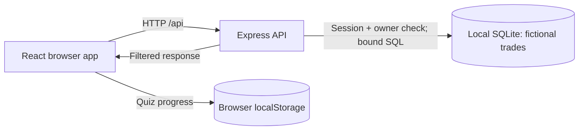

# App Security Lab

A local, beginner-friendly cybersecurity laboratory. **All users, passwords, trades, and findings are fictional.** Insecure snippets are displayed as text; the real API checks authorization. This is educational software, not production authentication software. Passing tests does not prove complete security.

## Run locally

Requires Node.js 24+ and npm. From this repository:

```powershell
npm install
npm run dev
```

Open **http://127.0.0.1:5173**. The Express API listens on **127.0.0.1:3001**. Both bind to localhost. No account, external target, or real credential is needed. SQLite creates `data/lab.sqlite`, which Git ignores. Delete that file while the app is stopped to reset the synthetic server records. Browser quiz progress and preferences live in localStorage; clear this site's browser storage to reset them.

| Command | Purpose |
| --- | --- |
| `npm run dev` | Start the frontend and API together |
| `npm run lint` | Check code quality |
| `npm run typecheck` | Check TypeScript |
| `npm test` | Run UI, unit, and API tests |
| `npm run test:api` | Run protected API tests only |
| `npm run build` | Build static frontend assets |
| `npm run audit` | Review production dependency advisories |

`dist/` contains frontend assets, not a stand-alone deployment. The lessons expect the localhost API. Do not publish this lab as an exposed service.

## Understand the system

Cybersecurity protects systems and information from unauthorized access, changes, and disruption. Authentication asks **“Who are you?”** Authorization asks **“May you access this specific resource?”** A signed-in user does not own every database row. The browser is controlled by its user, so access checks belong on the server.



The frontend presents lessons and sends requests. The backend validates input, checks the session and owner, then queries SQLite. It holds two synthetic trades. Browser quiz progress is separate from server records. No external site is queried.

## Use the eight labs

1. **Authentication & authorization:** Sign in as Alice (`alice-demo`) or Bob (`bob-demo`). Try a wrong password, view your own trade, request the other user's trade, and log out. Sessions expire after 15 minutes.
2. **Broken access control / IDOR:** Request Trade `#101` (Alice) and `#202` (Bob). The real API returns `404` for a record outside your ownership. `401` means no session; `403` means forbidden; `404` means no accessible record; `200` means success.
3. **SQL injection:** Type SQL-looking input and compare interpolated query *text* with a bound parameter. No vulnerable query is executed. SQL queries relational databases; injection occurs when input becomes query instructions.
4. **XSS:** Type malicious-looking HTML and see it rendered as plain text. Reflected XSS appears in a response; stored XSS is saved then displayed. Safe text rendering and output encoding prevent input from becoming browser code. Content Security Policy adds defense in depth.
5. **Credentials & secrets:** Expand each type. A public API key differs from a server secret. Never commit or ship passwords, session tokens, service-role keys, or database passwords in browser code. `.env.example` has placeholders only. Exposed secrets require revocation and rotation.
6. **Database security & RLS:** Switch user and policy to see simulated row visibility. This is **not PostgreSQL enforcement**. The real API independently checks owners. Database roles should have minimum permissions, and backups need recovery tests.
7. **Dependency security:** Inspect fictional advisory severities and `npm ci`/`npm audit`. Direct packages are selected by developers; transitive packages come through them. A lockfile fixes resolved versions. Typosquatting imitates a package name. No malicious package is installed.
8. **API security:** Send preselected local GET and POST requests. The API uses session middleware, ownership filtering, Zod validation, a simple login rate limit, an Origin allowlist, security headers, bounded bodies, and generic errors. The explorer cannot scan external URLs.

Each lab also has a flow diagram, defensive use case, key lessons, and a short quiz. English and Indonesian learning copy are available; code and protocol terms stay in their original form.

## Security boundaries and limitations

- The server and Vite bind to `127.0.0.1`; no deployment workflow is included.
- Private routes require a valid cookie session. SQL uses parameters and ownership in the lookup. Unowned and absent trades both return `404` so private record existence is not disclosed.
- Sign-in uses fixed **dummy** credentials and in-memory sessions. It has no password hashing, registration, reset, MFA, distributed session storage, or production-grade abuse protection. Never adapt this sign-in code for real users.
- Cookies are HttpOnly and SameSite Strict. They lack `Secure` because local development uses HTTP. A real HTTPS application needs Secure cookies and a full security review.
- The API refuses unexpected browser Origins and does not enable cross-origin requests. This is not a substitute for full CSRF analysis in a real product.
- SQL, XSS, and RLS demos simulate unsafe behavior without running vulnerable handlers or submitted JavaScript. No real credentials or user data are collected.
- Rate limiting is in-memory and only suitable for the local lesson. Logs do not include request bodies or credentials.
- A green audit or CI run does not establish that software is completely secure.

## GitHub automation

The workflow in `.github/workflows/ci.yml` installs from the lockfile, runs lint, TypeScript, tests including authorization, build, and a separate dependency audit. GitHub Actions runs these checks on a temporary runner for pushes and pull requests; it does not deploy. Actions are pinned to commits and repository permission is read-only. Dependabot proposes npm and Actions updates.

In repository **Settings → Security / Code security and analysis**, enable Dependabot alerts, security updates, and secret scanning where available. In branch protection or rulesets, require CI before merging. Review each advisory's affected version, exposure, and fix; severity alone is not a complete risk assessment. Dependency review on pull requests may require a separate GitHub feature or action depending on repository eligibility. If a real credential is ever committed, revoke and rotate it before cleaning history.

## Optional Supabase/PostgreSQL example

This project needs no Supabase account. In a separately configured PostgreSQL project, an owner policy may look like:

```sql
ALTER TABLE public.trades ENABLE ROW LEVEL SECURITY;
CREATE POLICY "owner can read" ON public.trades
FOR SELECT TO authenticated
USING (owner_id = (SELECT auth.uid()));
```

That assumes compatible `owner_id` and `auth.uid()` types, proper grants and roles, and multi-user policy tests. RLS does not replace an understanding of elevated service roles, permissions, and backups.

## Project map

- `src/` — React pages, responsive UI, browser-only simulations, lab lessons
- `server/` — Express API, SQLite, authorization tests
- `.github/` — CI and Dependabot
- `docs/` — defensive notes

The source is intentionally compact so beginners can follow browser → API → database without extra framework layers.
